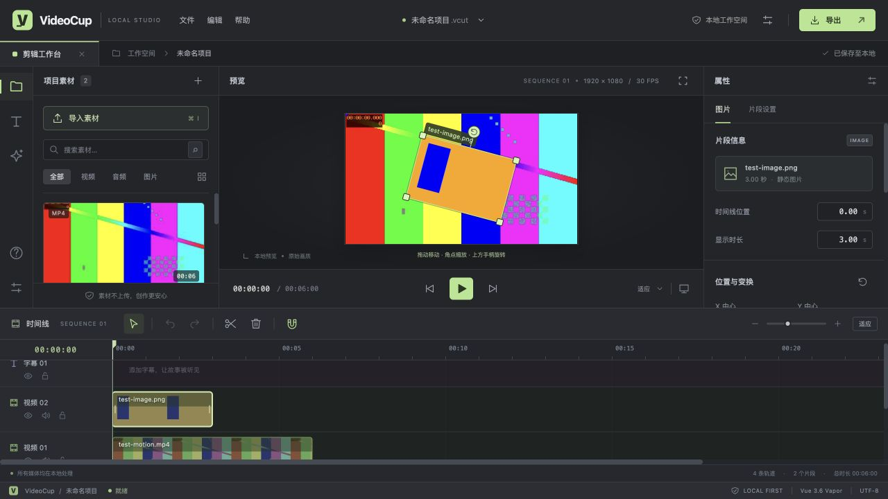

<div align="center">


<h1>VideoCup</h1>

<p><strong>剪辑、字幕、配音，在浏览器里一气呵成。</strong></p>

<p>一个本地优先的轻量 Web 视频剪辑工作台。<br />多轨时间线 · 一键 AI 配音 · 可视化画面编辑 · 本机加速导出</p>

<p>
  <a href="https://github.com/onlyGuo/VideoCup/stargazers"></a>
  <a href="https://github.com/onlyGuo/VideoCup/network/members"></a>
  <a href="https://github.com/onlyGuo/VideoCup/issues"></a>
</p>

<p>
  
  
  
  
  
</p>

<p>
  <a href="#功能亮点">功能亮点</a> ·
  <a href="#快速开始">快速开始</a> ·
  <a href="#一键-ai-配音">AI 配音</a> ·
  <a href="#导出与部署">导出与部署</a> ·
  <a href="./docs/DEVELOPMENT.md">开发文档</a> ·
  <a href="https://github.com/onlyGuo/VideoCup/issues">反馈问题</a>
</p>



<p><sub>熟悉的 IDEA 风格暗色界面，让素材、预览、属性与时间线各就其位。</sub></p>

</div>

## 功能亮点

<table>
  <tr>
    <td width="50%" valign="top">
      <h3>🌐 浏览器就是工作台</h3>
      <p>在现代桌面浏览器中剪辑，跨平台使用。轻量 Web 界面基于 Vue Vapor，编码内核按需启动，适合录屏讲解、产品演示和日常剪辑。</p>
    </td>
    <td width="50%" valign="top">
      <h3>🎬 多种素材，一条创作流程</h3>
      <p>视频、图片、音频、字幕多轨协作。拖放素材，分割与裁剪片段，调整速度、音量与透明度，随时预览组合效果。</p>
    </td>
  </tr>
  <tr>
    <td width="50%" valign="top">
      <h3>🗣️ 字幕一键变配音</h3>
      <p>内置 Edge TTS，选中字幕即可生成语音。提供多种中文音色与语速、音调调节，声音自动加入音轨并与字幕对齐。</p>
    </td>
    <td width="50%" valign="top">
      <h3>🎛️ 画面直接上手调整</h3>
      <p>在预览画面中拖动、缩放、旋转视频、图片与字幕。配合画面裁剪和属性面板，完成画中画、图片叠加和字幕排版。</p>
    </td>
  </tr>
  <tr>
    <td width="50%" valign="top">
      <h3>⚡ 本机加速，兼容导出</h3>
      <p>优先使用本机 FFmpeg 与可用的硬件编码，支持浏览器 WASM 兼容模式。导出 MP4、MP3，也能单独保存 SRT 字幕。</p>
    </td>
    <td width="50%" valign="top">
      <h3>💾 素材在本地，工程可带走</h3>
      <p>浏览器自动保存编辑内容，支持撤销与重做。下载包含素材和剪辑设置的 .vcut 工程，方便备份和在另一台设备继续编辑。</p>
    </td>
  </tr>
</table>

> **本地优先**：视频、图片和音频的预览、剪辑、导出均在你的设备上处理。AI 配音需要联网，会将待合成的字幕文本发送至语音服务。推荐使用桌面版 Chrome 或 Edge，其他浏览器的能力说明见下方 FAQ。

## 能做些什么

| 模块           | 能力                                                                                        |
| -------------- | ------------------------------------------------------------------------------------------- |
| **素材管理**   | 拖放导入、搜索与分类；支持 MP4、MPV、MOV、WebM、MP3、WAV 等媒体，以及 PNG、JPG、WebP 等图片 |
| **时间线剪辑** | 多轨道、拖动排序、分割、边缘裁剪、吸附、缩放、轨道静音 / 隐藏 / 锁定                        |
| **画面与声音** | 0.25–4 倍速、位置 / 大小 / 旋转、裁剪、透明度、音量调节、视频音轨分离                       |
| **图片叠加**   | 图片进入视频轨道，默认显示 5 秒；可调整时长与变换，保留透明背景                             |
| **字幕与配音** | 字幕样式编辑、中文音色选择、一键生成语音、字幕与声音自动对齐、关联编辑                      |
| **导出成片**   | MP4（H.264 + AAC）、MP3、SRT；480p / 720p / 1080p，支持烧录字幕                             |
| **工程管理**   | IndexedDB 自动保存、`.vcut` 完整工程导入 / 导出、撤销 / 重做                                |

## 快速开始

推荐 **Node.js 24** 和桌面版 **Chrome / Edge**。

```bash
git clone https://github.com/onlyGuo/VideoCup.git
cd VideoCup
npm install
npm run dev
```

打开终端显示的本地地址，通常为 **http://127.0.0.1:5173/**。

首次安装会下载当前系统对应的 FFmpeg，用于本机加速导出；启动后，内置配音与导出服务会随工作台一起运行。

### 从素材到成片，四步开始

1. **导入素材**：点击「导入素材」，或把视频、图片、音频拖进窗口。
2. **排好时间线**：双击素材或拖入轨道；选择片段，在右侧调整速度、裁剪和画面变换。
3. **加字幕与声音**：添加字幕，点击「生成 AI 配音」，语音自动加入音轨。
4. **保存与导出**：用 `Ctrl / ⌘ S` 保存完整工程；点击「导出」，生成 MP4 或 MP3。

也可以点击 **「体验示例项目」**，直接体验完整剪辑流程。

## 一键 AI 配音

**写好字幕 → 选择音色 → 生成配音。**

内置实现基于 [ssrsss/ttsapi](https://github.com/ssrsss/ttsapi)，通过本地服务接入 Edge TTS。使用默认服务时无需填写模型或 API Key，也无需安装或打开 Edge 浏览器。

- **21 个中文声音候选**：可搜索音色、筛选语言、试听声音。
- **声音可调**：支持语速、音调、音量及风格候选，具体风格取决于上游音色支持。
- **字幕与声音一起编辑**：生成后自动对齐时长；关联状态下，移动、变速、分割与删除联动。
- **服务可扩展**：内置统一 `SpeechProvider` 接口，可接入自部署 ttsapi 或其他兼容语音服务。

选中字幕后，在右侧「AI 语音字幕」区域点击 **「生成 AI 配音」**。音色与连接选项位于 **「配音服务设置」**。

<details>
<summary><strong>配音服务说明</strong></summary>

默认配音需要联网，上游可能限流、暂时不可用，或不支持某个音色 / 风格。本地接口单次最多接受 5,000 个 Unicode 字符。

修改字幕文字后需重新生成声音；解除字幕与声音的关联后，可以分别剪辑。自定义服务的 API Key 仅保留在当前页面内存中。

更多接口、请求示例与接入方式见 [开发文档](./docs/DEVELOPMENT.md#配音扩展机制)。

</details>

## 导出与部署

默认选择 **「自动 · 优先本机加速」** 即可。处理都在本机进行，支持取消任务；编码完成后点击「下载文件」。

| 运行方式                            | 视频导出                           | 内置 AI 配音           |
| ----------------------------------- | ---------------------------------- | ---------------------- |
| `npm run dev`                       | 本机 FFmpeg 优先，浏览器 WASM 可选 | 可用，需联网           |
| `npm run build` + `npm run preview` | 本机 FFmpeg 优先，浏览器 WASM 可选 | 可用，需联网           |
| 仅静态部署 `dist/`                  | 浏览器 WASM 兼容模式               | 需配置自部署或兼容服务 |

本机引擎支持原生多线程编码；macOS 会优先尝试 VideoToolbox，硬件不可用时回退软件编码。浏览器兼容模式采用分段渲染与有限内存策略。实际速度取决于素材、画面效果和设备性能。

<details>
<summary><strong>部署与导出注意事项</strong></summary>

- 浏览器版编码内核约 32 MB，按需加载，随构建打包。
- 静态部署需要 HTTP(S)、Worker 和 WebAssembly 支持，并正确返回 `.wasm` 文件。
- 本机导出服务仅接受回环地址的同源请求，原始素材流式传到本机临时目录。成片闲置 1 小时后清理，请及时下载。
- 可通过 `VIDEOCUP_FFMPEG_PATH` 指定本机 FFmpeg；默认使用 `ffmpeg-static`，也会尝试系统 PATH。
- 开发服务与本机预览服务用于本地运行；自部署详情见 [开发文档](./docs/DEVELOPMENT.md#部署与数据)。

</details>

## 常见问题

<details>
<summary><strong>任何浏览器都可以使用吗？</strong></summary>

工作台基于 Web 标准构建，面向现代桌面浏览器。当前推荐桌面版 Chrome / Edge；其他浏览器的媒体解码、WebAssembly、文件保存能力可能不同，部分功能需要兼容处理。移动端尚未专门适配。

内置配音和本机加速导出由 Node.js 本地服务提供。仅部署前端时，可使用浏览器兼容导出，并单独配置配音服务。

</details>

<details>
<summary><strong>工程会自动保存吗？如何换设备继续编辑？</strong></summary>

工程自动保存在当前浏览器、当前站点的 IndexedDB 中，刷新后可恢复。清理浏览器数据或更换访问地址会影响这份本地副本。

用「文件 → 保存工程」或 `Ctrl / ⌘ S` 下载 `.vcut` 文件，其中包含素材与剪辑设置；在另一台设备中通过「文件 → 打开工程」继续编辑。建议定期保存独立工程备份。

</details>

<details>
<summary><strong>MOV、MPV 和动图可以导入吗？</strong></summary>

支持导入 MOV、MPV 等格式。浏览器无法解码的视频会尝试在本地转换为兼容格式；具体支持取决于浏览器和 FFmpeg 构建。

GIF、BMP、AVIF 等图片会转为静态 PNG 画面，GIF 目前按静态首帧使用。

</details>

## 开发与扩展

**Vite 8 · Vue 3.6 RC / Vapor Mode · TypeScript · Canvas · IndexedDB · FFmpeg · Edge TTS**

```bash
npm test          # 单元测试与真实 FFmpeg 编码 / 解码回归
npm run build     # 类型检查与生产构建
npm run preview   # 本地预览，包含配音与本机导出 API
```

- [开发与架构说明](./docs/DEVELOPMENT.md)：预览、变换、工程格式、导出流程与 API。
- [配音扩展机制](./docs/DEVELOPMENT.md#配音扩展机制)：统一服务接口与自定义音色列表。
- [GitHub 发布资料](./docs/GITHUB.md)：仓库简介、Topics 与展示素材。

欢迎通过 [Issues](https://github.com/onlyGuo/VideoCup/issues) 反馈问题，或提交 [Pull Request](https://github.com/onlyGuo/VideoCup/pulls) 一起改进。

## 致谢

感谢 [Vue](https://github.com/vuejs/core)、[Vite](https://github.com/vitejs/vite)、[FFmpeg](https://ffmpeg.org/)、[ffmpeg.wasm](https://github.com/ffmpegwasm/ffmpeg.wasm) 与 [ssrsss/ttsapi](https://github.com/ssrsss/ttsapi) 提供基础能力。

ttsapi 的来源和 MIT 许可见 [third_party/ttsapi](./third_party/ttsapi/README.md)。FFmpeg 相关组件的许可说明见 [开发文档](./docs/DEVELOPMENT.md#结构与许可)。

---

<div align="center">
<p><strong>喜欢 VideoCup？欢迎点一颗 Star，让更多人发现它。</strong></p>
<p><a href="https://github.com/onlyGuo/VideoCup">onlyGuo / VideoCup</a></p>
</div>
